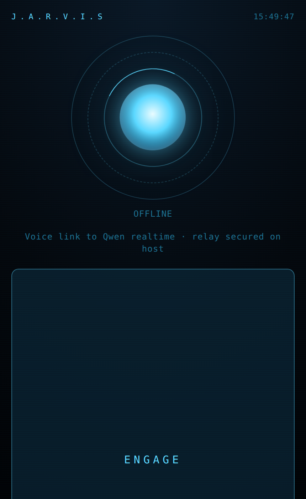

# JARVIS — phone voice agent + PC agent orchestrator

Talk to your PC from your phone. A realtime voice model hears you, a Qwen orchestrator decides
which coding agent should do the work, that agent works in an isolated git worktree, and JARVIS
tells you when it's done — or merges it into main when you say so.

```
 phone (Flutter)          PC host (node)                     executors
 ┌──────────────┐   wss   ┌─────────────────────────┐        ┌──────────────────┐
 │ mic 16k PCM  │ ──────► │ relay + persona + tools │ ─────► │ claude -p        │
 │ spk 24k PCM  │ ◄────── │ qwen-audio-3.0-realtime │        │ codex exec       │
 └──────────────┘         │ router: qwen3.8-max     │        │ qodercli (qwen)  │
                          └─────────────────────────┘        └──────────────────┘
```



**What it demonstrates**

- **Realtime voice agent with function calling.** Speech in, speech out over a websocket relay, with
  barge-in, echo-safe playback and tool calls; Qwen and OpenAI realtime models behind one protocol.
- **LLM routing across coding agents.** A Qwen orchestrator picks Claude Code, Codex or Qoder for each
  job, honours spoken overrides, and benches an executor for 30 minutes when it hits a rate limit.
- **Safe autonomy.** Every job runs in its own git worktree and branch; nothing touches your working
  tree until you say "merge it".
- **Cost-aware sessions.** Follow-ups resume the same agent session while the prompt cache is warm
  (measured below: 46,946 cached tokens read vs 2 fresh input tokens).

<br clear="right">

The phone only streams audio. The persona, the tools, the API key and all orchestration live on
the PC, so the app never changes when the brain does.

## Run it

```bash
npm start                       # HTTPS host + voice relay on :8443
```

Then open the app on the phone (or `https://<pc-ip>:8443/` in Chrome for the debug console) and
press **ENGAGE**. The certificate is self-signed; accept the warning once. In the app, set the host to your PC's
address (it is saved on the phone).

`.env`:

| key | meaning |
|---|---|
| `OPENAI_API_KEY` | when set, the voice runs on OpenAI's realtime model instead of Qwen |
| `OPENAI_REALTIME_MODEL` | default `gpt-realtime-2.1` |
| `OPENAI_VOICE` | `cedar` (default) or `marin`, `alloy`, `ash`, `ballad`, `coral`, `echo`, `sage`, `shimmer`, `verse` |
| `VOICE_PROVIDER` | force `openai` or `qwen`; otherwise OpenAI whenever its key is set |
| `QWEN_API_KEY` | Token Plan key (`sk-sp-…`); also used by the task router |
| `QWEN_REALTIME_URL` | realtime websocket + model |
| `JARVIS_VOICE` | `daniel` (also `loongjohn`, `echo`, `hannah`, `sherry`, `loongmary`, …) |
| `PROJECT_ROOTS` | colon-separated dirs to resolve spoken project names against |
| `ORCHESTRATOR_MODEL` | routing brain, default `qwen3.8-max` |
| `QODER_BIN`, `QODER_MODEL` | Qoder CLI path and model id |
| `JARVIS_SCRATCH` | where projectless jobs run |
| `JARVIS_STATE` | where sessions and agent pointers are stored |
| `AGENT_SESSION_TTL_MIN` | resume an agent session only if used within this window (180) |
| `JOB_CONTINUE_WINDOW_MIN` | reuse an unmerged job's branch for follow-ups (180) |

## What you can say

- *"In the pond detection project, fix the failing dataloader test."* → routed, dispatched, isolated
- *"Use opus for this one."* → your choice overrides the router
- *"What's it doing?"* → live status, in speech, not logs
- *"Merge it into main."* → merges that job's branch, or explains why it can't
- *"Cancel that."* → kills the run
- *"Clear the session for pond detection."* → next task starts a fresh agent

## Sessions

Three things persist, and all three are visible on the phone:

**Conversation sessions** — every ENGAGE opens a named session, saved under `state/conversations/`.
The SESSIONS tab lists them (turns, jobs, preview, age); tap one to resume it. On resume the host
hands the voice model a recap of that session, so it genuinely remembers: ask it what you agreed
earlier and it knows. Swipe a session to delete it.

**Live job panel** — the JOBS tab shows every dispatched job with its agent, project, branch and
live progress beat, badged with the number still running. Tap for the full report.

**Agent sessions** — a follow-up in the same project resumes the same underlying CLI session
*and* continues on the previous job's branch, so the agent still has both its context and the
files it just wrote. Say *"clear the session for pond detection"* to start fresh; the old session
stays on disk and is simply no longer pointed at.

Resuming is also what keeps it cheap. A measured follow-up:

| | input | cache write | cache read | output |
|---|---|---|---|---|
| fresh session | 34 | 36,936 | 43,150 | 145 |
| resumed | 2 | 589 | 46,946 | 3 |

That holds while the provider's prompt cache is warm; past `AGENT_SESSION_TTL_MIN` (default 180)
a new session starts instead of paying to re-ingest the whole history.

## How work is isolated

Every job with a project gets `jarvis/<id>` as a branch and a worktree under `.jarvis-worktrees/`.
Agents run with full autonomy **inside** that worktree; your working tree is never touched until
you ask for a merge. If a worktree can't be created, the job is refused rather than run in place.
Build artefacts (`__pycache__`, `node_modules`, …) are excluded before the auto-commit so they
never block the merge.

## Executors

| key | CLI | notes |
|---|---|---|
| `claude:fable` / `:sonnet` / `:opus` | `claude -p` | fast / balanced / deepest |
| `codex:terra` / `:sol` / `:luna` | `codex exec` | fast / balanced / heavier |
| `qoder:max` | `qodercli` | Qwen3.8-Max, independent quota |

`astra` is not available on a ChatGPT-account Codex login. When a CLI reports a rate or credit
limit, that executor is put on a 30-minute cooldown and the router stops choosing it.

## Layout

```
server.js               host: HTTPS, voice relay, tool execution, announcements
orchestrator/
  index.js              tool schemas + job lifecycle
  router.js             qwen3.8-max routing, explicit overrides, heuristic fallback
  executors.js          CLI invocation + per-dialect progress parsing
  git.js                worktrees, junk exclusion, merge, cleanup
  projects.js           spoken name -> directory
  registry.js           job state, cooldowns, speech-shaped descriptions
  sessions.js           conversation transcripts + agent session pointers
state/                  saved sessions (conversations/, agent-sessions.json)
app/lib/link.dart       websocket + native audio + all client state
app/lib/main.dart       voice / jobs / sessions views
public/                 browser debug console (same protocol as the app)
```

## License

This project is licensed under the [PolyForm Noncommercial License 1.0.0](LICENSE): free for personal,
research, education and other noncommercial use. It is source-available, not an OSI-approved
open-source license.

**Commercial use requires a separate license.** Contact Charalambos Rotsides at
[lhampis@gmail.com](mailto:lhampis@gmail.com).
